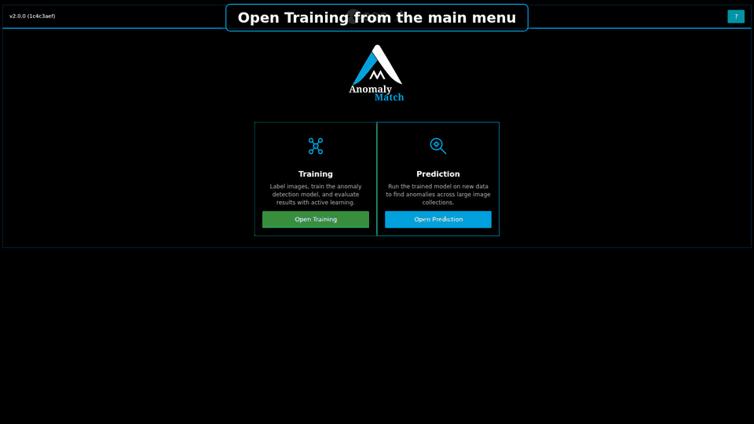
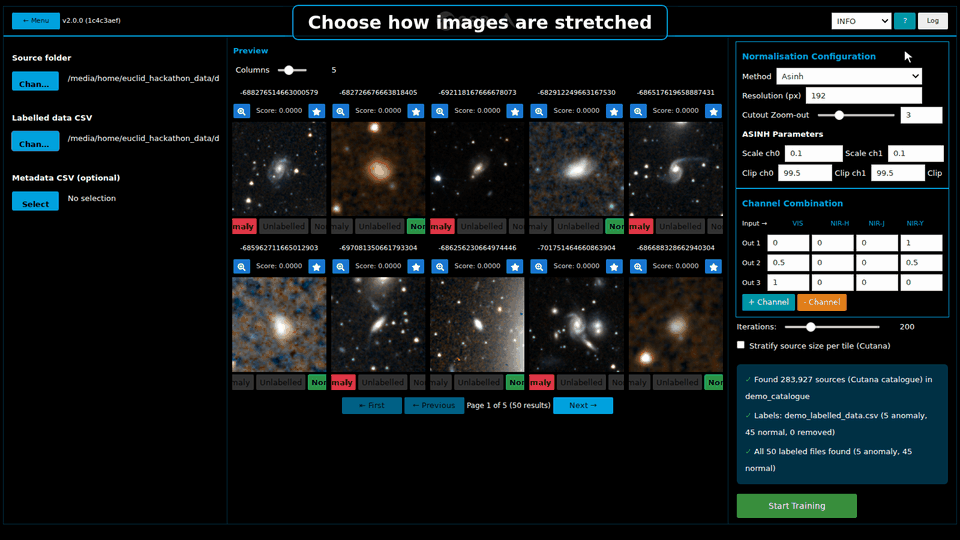
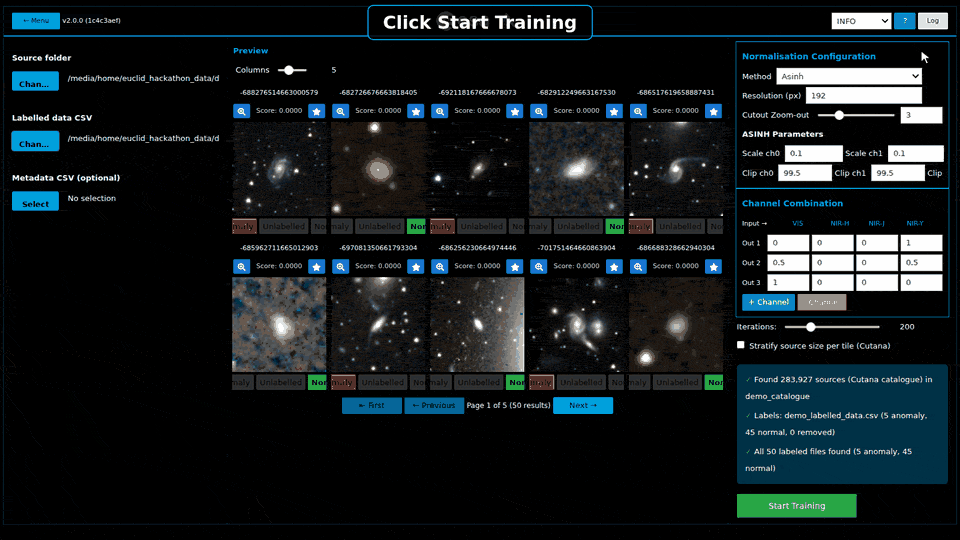
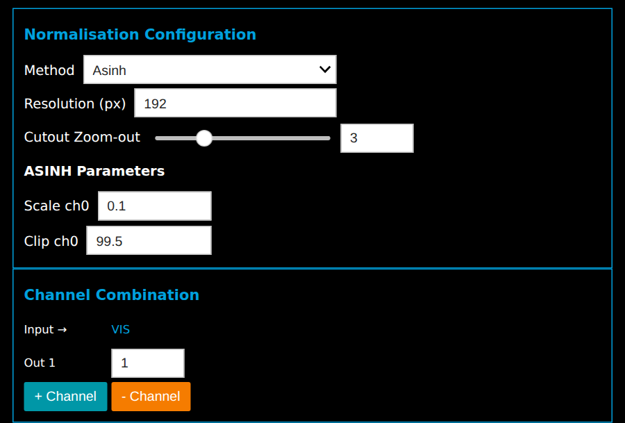
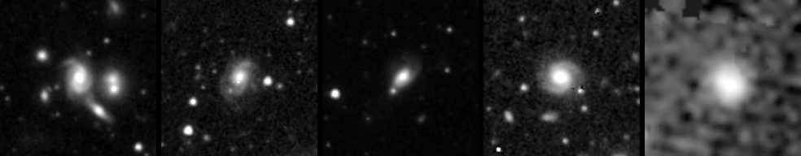
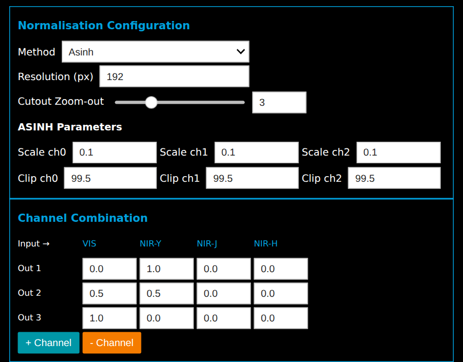
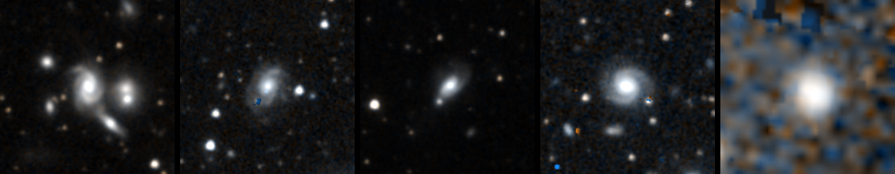
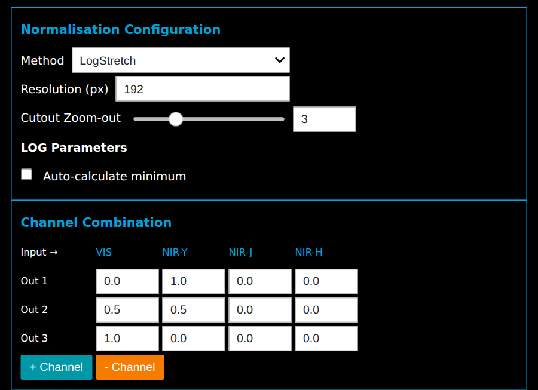
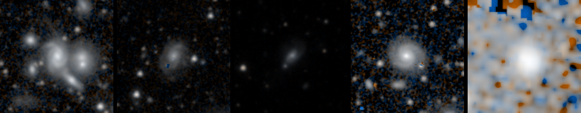

[//]: # (Copyright &#40;c&#41; European Space Agency, 2025.)
[//]: # ()
[//]: # (This file is subject to the terms and conditions defined in file 'LICENCE.txt', which)
[//]: # (is part of this source code package. No part of the package, including)
[//]: # (this file, may be copied, modified, propagated, or distributed except according to)
[//]: # (the terms contained in the file 'LICENCE.txt'.)

# ESA Datalabs Euclid Hackathon 2026

The Euclid Hackathon takes place from 23 to 26 November 2026. Teams compete to find the
rarest and most remarkable objects in Euclid DR1, using benchmarked ESA methods or their
own approaches. Each team's finds are scored on their rarity and scientific value, and the
top-scoring teams win prizes. AnomalyMatch is well suited to this kind of search.

Everything you need to start hunting is available as an app on
[ESA Datalabs](https://datalabs.esa.int/). The app comes with AnomalyMatch installed,
access to the full DR1 catalogue, and GPU computing resources. It also includes a welcome
notebook that explains how to submit your finds, along with other useful information.

## Source IDs

Every source in the DR1 catalogue has a unique `SourceID`, a large integer such as
`-701751464660863904`. AnomalyMatch shows it above each cutout. Source IDs are what you
submit, so note the IDs of the interesting objects you find.

## Quick start: hunting with AnomalyMatch

### 1. Select a source catalogue and labels

Choose the source catalogue and the labelled data CSV in the top-left corner. On your Datalabs hackathon instance in the folder `/euclid_hackathon_data` the
full DR1 catalogue and a smaller demo catalogue with its own labels is available, so you can
quickly get a feel for using and configuring AnomalyMatch.

### 2. Preview and configure the normalisation

The normalisation controls how the raw Euclid bands are stretched and combined into the
images that you and the model see. Adjust it until the features you care about stand out.
The preview updates as you change the settings. See
[Normalisation suggestions](#normalisation-suggestions) below for some starting points.

### 3. Run the training loop

Train the model, then review the sources it scores as most anomalous. Label them as
anomalous or normal, and retrain. Each round teaches the model more about what you are
looking for, whether that is gravitational lenses, merging galaxies, protoplanetary
disks or something nobody has catalogued yet.

## Normalisation suggestions

Some good starting points for step 2. Each preset shows the settings, followed by the same
five sources from the demo catalogue as they look with those settings.

**A quick look** (VIS only): a single greyscale band.

**A Galaxy Zoo look**: VIS and NIR-Y combined into colour images.

**Faint, extended structure and surroundings**: a logarithmic stretch that brings out faint
features such as tidal tails and halos, at the cost of brighter noise.

For what each method and parameter does, see [Configuration](user-guide/configuration.md#normalisation).

## Going further

Be creative with AnomalyMatch. The rest of the documentation covers what the quick start
leaves out:

- [Getting Started](getting-started.md): installation, label files and session tracking
- [Training](user-guide/training.md): the setup screen and each step of the training cycle
- [Prediction](user-guide/prediction.md): scoring catalogues and other data sources
- [Headless Mode](user-guide/headless.md): train and score from your own scripts, with no UI
- [Configuration](user-guide/configuration.md): every configuration option
- [Method](method.md): the semi-supervised method behind AnomalyMatch

You can also modify the catalogue with your own scripts, or try something completely different.
