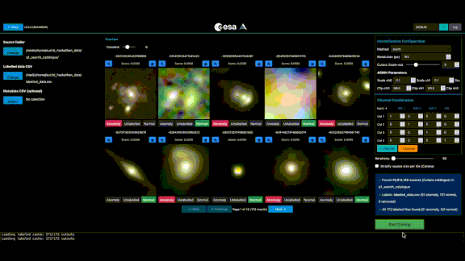
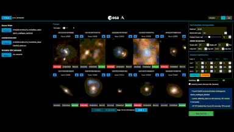
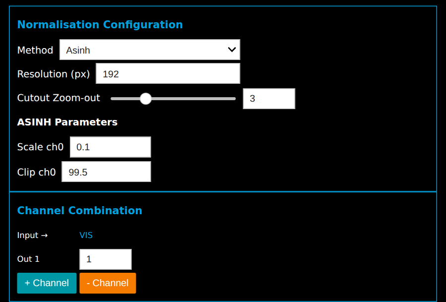
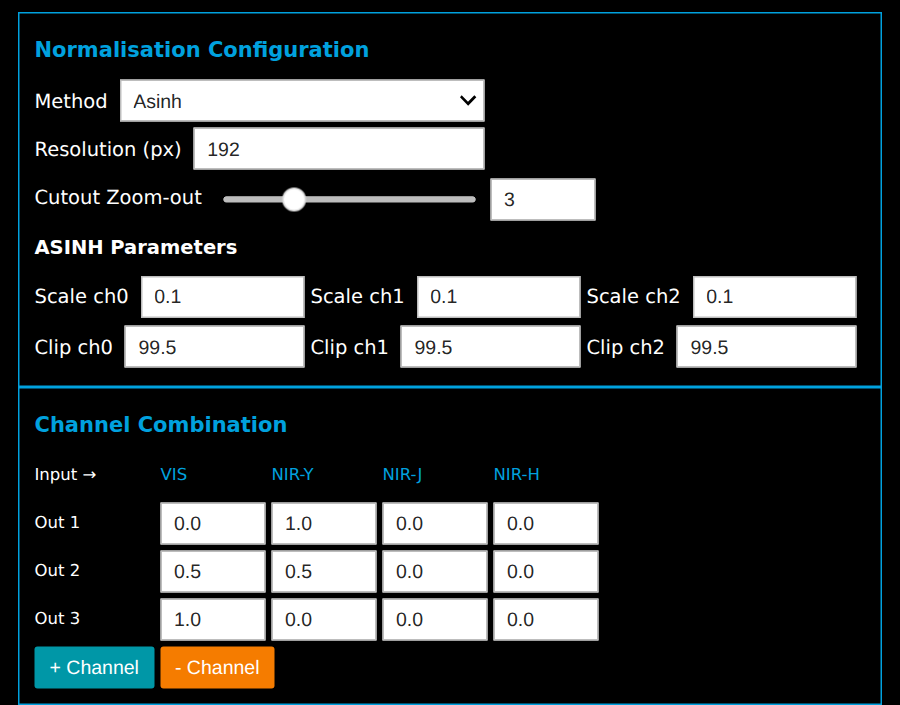
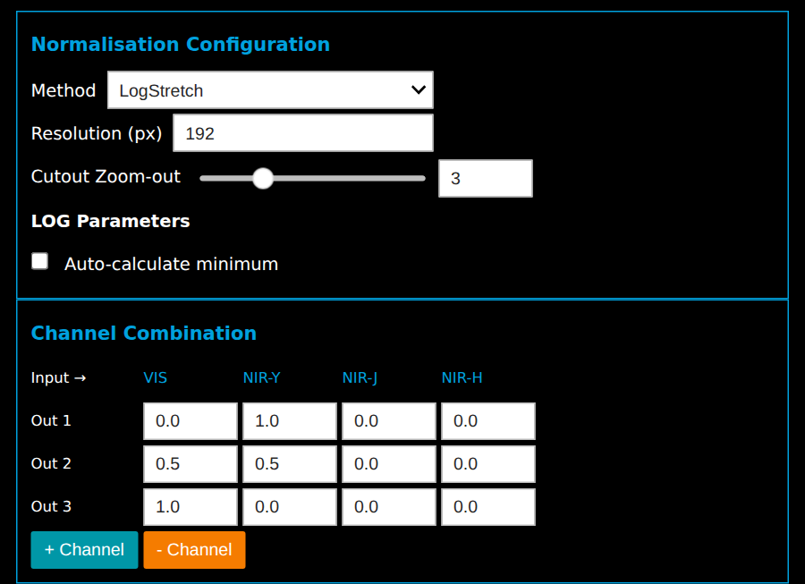

[//]: # (Copyright &#40;c&#41; European Space Agency, 2025.)
[//]: # ()
[//]: # (This file is subject to the terms and conditions defined in file 'LICENCE.txt', which)
[//]: # (is part of this source code package. No part of the package, including)
[//]: # (this file, may be copied, modified, propagated, or distributed except according to)
[//]: # (the terms contained in the file 'LICENCE.txt'.)

# ESA Datalabs Euclid Hackathon 2026
The Euclid Hackathon takes place 23 to 26 November 2026 where teams will go head-to-head to surface the rarest and most remarkable objects in DR1, using benchmarked ESA methods or approaches of their own. The rare objects found by each team will be scored by their rarity and scientific value, with the top scoring teams winning prizes. AnomalyMatch is a great tool for that.  

A convenient app with AnomalyMatch and everything else you initially need to hunt these rare objects is made available on [ESA Datalabs](https://datalabs.esa.int/). It has access to the full DR1 catalogue and a computing resources. An introducing notebook for submissions and other relevant information is also available here. 

## Quick start for using AnomalyMatch to hunt 
### 1. Select a source catalogue and labels
Source and labels should be selected in the top left corner. The full DR1 catalogue as well as a convenient smaller demo DR1 catalogue is available for quickly getting the feel of using and configuring AnomalyMatch. 

### 2. Preview and configure normalisations for sources
Configure normalisation to your preference for inferring which galaxies are interesting. 

### 3. Training loop 
Run the training workflow to find sourceID's - Train, select new anomalies, retrain

### Advanced usages
We encourage being creative about using [AnomalyMatch](https://esa.github.io/AnomalyMatch/stable/). Run it in headless mode, change the catalogue using your own scripts or something completely different! Go craaaaazy. 

## Normalisation suggestions
Some good starting points for step 2:

**A quick look** (VIS only)

**A Galaxy Zoo look**

**Faint, extended structure and surroundings**

## Considerations 
* Be careful about running multiple instances of AnomalyMatch at once. Cutana uses all available memory.
* Submitting multiple times per window overwrites previous submission. 

more...  
